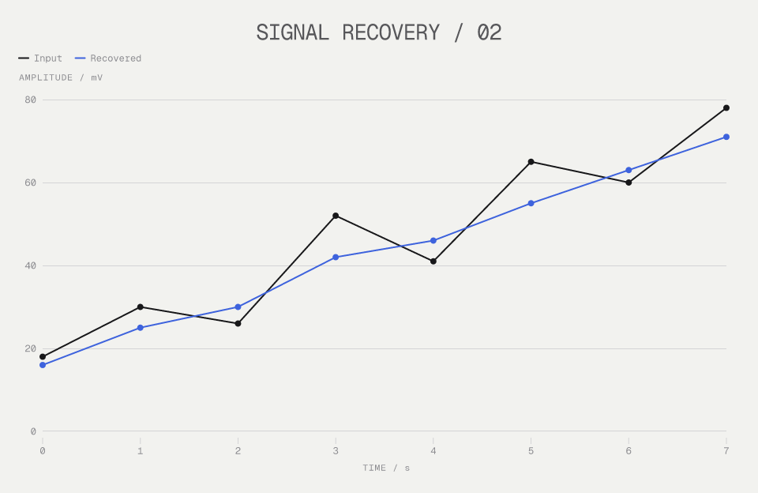
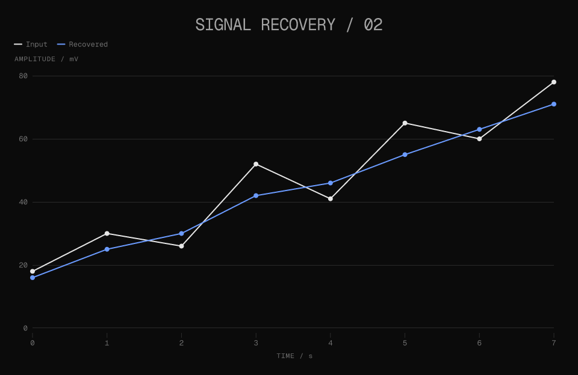
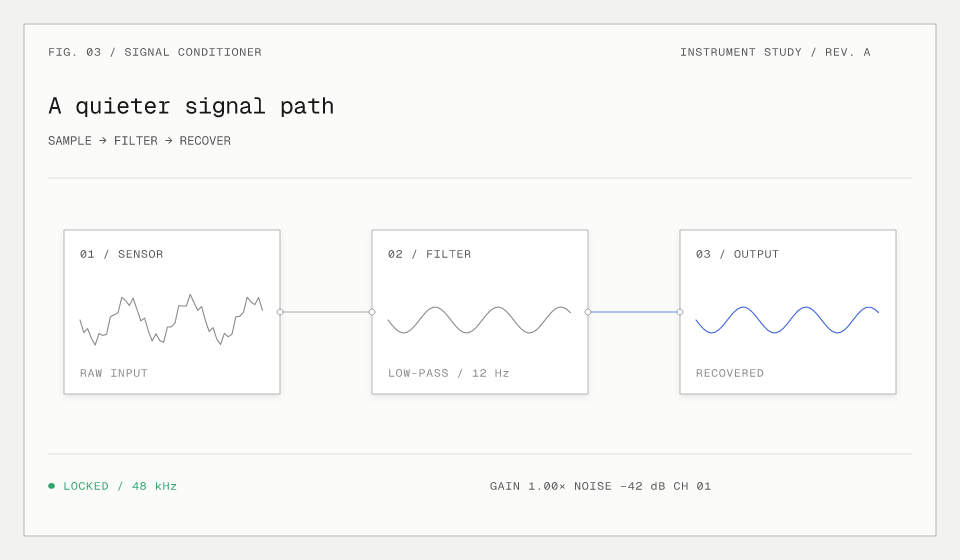
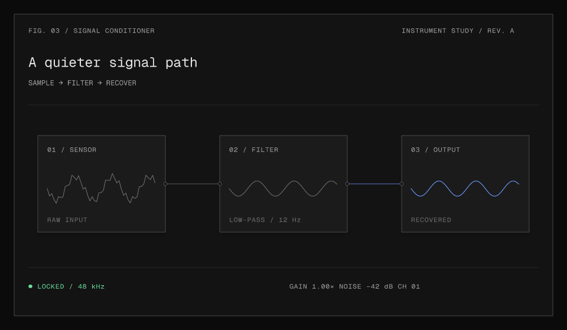

# Anatomy technical plates

`anatomyTheme` and `anatomyDarkTheme` are public `@kineglyph/core` exports, registered
as `glyphStyleThemes.anatomy` and `glyphStyleThemes["anatomy-dark"]`. They use the
existing semantic scene renderer: no isometric engine, CSS runtime, or new dependency.

```js
import { anatomyTheme, anatomyDarkTheme, resolveScene } from "@kineglyph/core";
const light = resolveScene(scene, { width: 960, theme: anatomyTheme });
const dark = resolveScene(scene, { width: 960, theme: anatomyDarkTheme });
```

HTTP supports both names for charts and full scenes in SVG, PNG, and GIF:

```text
/chart.png?data=12,18,45,32&theme=anatomy
/chart.svg?data=12,18,45,32&theme=anatomy-dark
```

## Design and adaptations

Warm light paper (`#f2f2ef`) or near-black ground (`#0b0b0b`), square technical
plates, 0.6-unit hairlines, compact medium-weight mono type, and a subtle portable
raised shadow leave the geometry in charge. The HTTP renderer uses bundled Geist
Mono; other renderers fall back to system monospace. No external font fetch is needed.
All semantic colors are scoped, including the canvas, so standalone dark exports
retain their background. Raised shadows use the existing portable material API.

Surface/card, face, text, muted, connector, border, and red/green/blue accent values
follow the source palette. `chart6` carries the strong ink; `chart4` and `chart5`
use readable gray inks rather than near-paper material shades. Warning is adapted
to restrained amber to remain distinct from danger. The source green is preserved:
its light-mode contrast is about 2.81:1 against the canvas, so don't use it as small
body text or as the sole carrier of meaning. Pair color with labels and geometry.
The presets intentionally live outside `professionalThemes`, whose flat-material
contract is unchanged. A theme does not override explicitly authored geometry,
stroke widths, or colors; choose semantic paints and material roles to inherit it.

## Reproducible specimens

Original source fixtures live in `examples/anatomy/fixtures.mjs`.
The instrument is built solely from existing rectangles, polylines, circles and text.

```sh
npm run bootstrap
node examples/anatomy/render.mjs
# Or write all eight SVG/PNG files to an explicit output directory:
node examples/anatomy/render.mjs /tmp/kineglyph-anatomy
```






## Inspiration and attribution

Inspired by Ryan's [Anatomy](https://github.com/wheresryan22/anatomy), specifically
[`kit/iso.css` at e6600ffc4e8e6620eeb45bf49bcdbd5e4b84163f](https://github.com/wheresryan22/anatomy/blob/e6600ffc4e8e6620eeb45bf49bcdbd5e4b84163f/kit/iso.css).
The palette and technical-plate direction are adapted; upstream CSS, geometry and
animation implementation are not vendored. The original specimens are Kineglyph
scene definitions. Anatomy is MIT licensed; the upstream notice is reproduced below.

```text
MIT License

Copyright (c) 2026 Ryan

Permission is hereby granted, free of charge, to any person obtaining a copy
of this software and associated documentation files (the "Software"), to deal
in the Software without restriction, including without limitation the rights
to use, copy, modify, merge, publish, distribute, sublicense, and/or sell
copies of the Software, and to permit persons to whom the Software is
furnished to do so, subject to the following conditions:

The above copyright notice and this permission notice shall be included in all
copies or substantial portions of the Software.

THE SOFTWARE IS PROVIDED "AS IS", WITHOUT WARRANTY OF ANY KIND, EXPRESS OR
IMPLIED, INCLUDING BUT NOT LIMITED TO THE WARRANTIES OF MERCHANTABILITY,
FITNESS FOR A PARTICULAR PURPOSE AND NONINFRINGEMENT. IN NO EVENT SHALL THE
AUTHORS OR COPYRIGHT HOLDERS BE LIABLE FOR ANY CLAIM, DAMAGES OR OTHER
LIABILITY, WHETHER IN AN ACTION OF CONTRACT, TORT OR OTHERWISE, ARISING FROM,
OUT OF OR IN CONNECTION WITH THE SOFTWARE OR THE USE OR OTHER DEALINGS IN THE
SOFTWARE.
```
