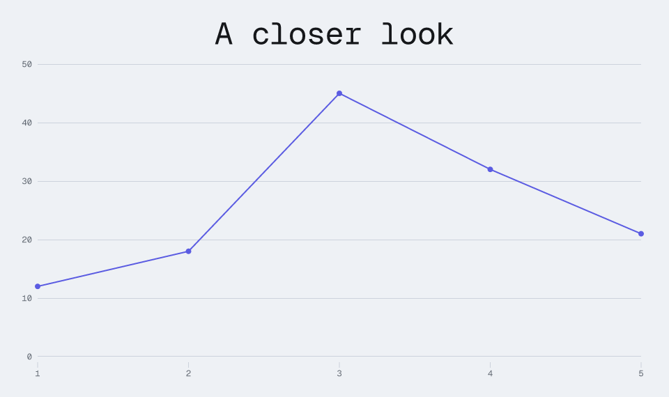
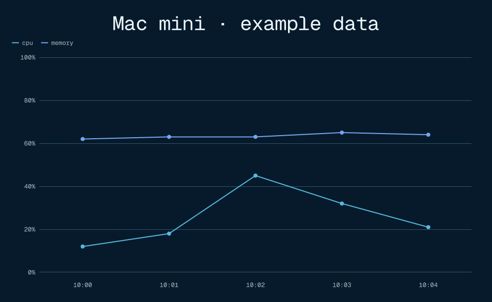

# Render a figure from a URL

`@kineglyph/server` turns data into SVG, PNG, or animated GIF over HTTP. Start with a short URL,
add chart controls when needed, or send an existing scene definition. The server reuses
Kineglyph's plot compiler, scene resolver, and exporters: it is a transport, not another renderer.

A monitor only collects measurements and creates URLs. It does not need a browser, fonts, image
encoders, or chart layout code. The rendering service needs Node.js; it does not require a
browser or database.

## Start from a checkout

Requires Node.js 22.12 or newer. From the repository root:

```sh
npm ci
npm run bootstrap
node packages/server/dist/cli.js serve --host 127.0.0.1 --port 4179
```

The package provides the `kineglyph-server` executable. It is separate from `kineglyph dev`,
which previews **trusted local modules**. HTTP rendering never imports a module selected by a
request. This guide describes the source checkout; merging the feature does not publish a new
npm release or deploy a public endpoint.

```sh
curl 'http://127.0.0.1:4179/chart.svg?data=12,18,45,32,21' -o chart.svg
curl 'http://127.0.0.1:4179/chart.png?data=12,18,45,32,21&title=CPU&unit=percent' -o cpu.png
curl 'http://127.0.0.1:4179/chart.gif?data=12,18,45,32,21&width=640' -o cpu.gif
```

The default line chart has inferred axes and a complete theme. Static output renders the final
frame. GIF is a sampled, finite animation baked into the response, not a live stream.



## Progressive configuration

### A few query parameters

```text
/chart.png?data=12,18,45,32,21&title=CPU&unit=percent&mark=area&theme=blueprint&width=800
```

For named series, supply one parameter per series:

```text
/chart.png?series.cpu=12,18,45,32&series.memory=62,63,63,65&x=10:00,10:01,10:02,10:03&y.min=0&y.max=100&unit=percent&legend=true
```

These are relative URL examples. Add your service origin, and use a URL helper to escape labels
and other special characters correctly.

- `data`: comma-separated numeric samples for one series; use `null` for a missing sample.
- `series.NAME`: named series instead of `data`. Do not mix both forms. Series and x-values must
  have equal lengths; missing data is not silently converted to zero.
- `x`: comma-separated labels or numeric positions. Use structured JSON for labels containing commas.
- `title`, `unit`: chart title and value formatting. `unit=percent` adds `%` to values already in
  percentage points; it does **not** multiply fractions by 100.
- `mark`: `line`, `area`, `bar`, or `dot`. More detailed per-series choices use a structured spec.
- `legend`: `true` or `false`.
- `x.label`, `y.label`: axis titles.
- `x.min` / `x.max`, `y.min` / `y.max`: paired domain endpoints. Numeric x domains require numeric
  x-values and a compatible mark. Invalid or reversed domains are errors.
- `theme`: `light` (default), `dark`, `kineglyph`, `blueprint`, `swiss`, `ledger`, `field-manual`,
  `studio`, `civic`, `anatomy`, or `anatomy-dark`. The service fixes the font family to bundled Geist Mono across themes.
- `width`: layout/container width, 240–1600 (default 960), not merely an image resize.
- `scale`: output scaling, 0.25–3 (default 1), without changing the layout breakpoint.
- `time`: a still-frame time in milliseconds, 0–2000, for SVG/PNG. Omit for the final frame.
  GIF always exports the timeline rather than a chosen still frame.
- `fps`: GIF sampling rate, 1–24 (default 8), subject to the frame and pixel budgets below.

Unknown options, duplicate query keys, malformed numbers, and ambiguous input are rejected.
The server will not guess that `widht` meant `width`.

### A structured chart

The JSON request gives each series its own mark and semantic colour:

```json
{
  "chart": {
    "title": "Mac mini · example measurements",
    "unit": "percent",
    "x": [0, 1, 2, 3],
    "xLabel": "Minutes",
    "yLabel": "Usage",
    "yDomain": [0, 100],
    "series": [
      { "name": "CPU", "data": [12, 18, null, 32], "mark": "area", "tone": "chart1" },
      { "name": "Memory", "data": [62, 63, 63, 65], "mark": "line", "tone": "chart2" }
    ]
  },
  "theme": "blueprint",
  "width": 960,
  "scale": 2
}
```

Save this as `request.json` and send it directly:

```sh
curl --fail-with-body -H 'Content-Type: application/json' \
  --data-binary @request.json http://127.0.0.1:4179/render.png -o dashboard.png
```

POST to these render routes returns image bytes, just like GET; it does **not** allocate a stored
image URL. A GET can carry the same request in the URL-encoded `spec` parameter. `spec` is
exclusive: put all options inside it rather than mixing it with shorthand parameters.

### Build URLs without the rendering dependencies

```ts
import { chartUrl } from "@kineglyph/server/client";

const minimal = chartUrl("https://glyph.example", { data: [12, 18, 45] });
// https://glyph.example/chart.png?data=12%2C18%2C45

const image = chartUrl("https://glyph.example", {
  chart: {
    title: "CPU",
    unit: "percent",
    series: [{ name: "CPU", data: [12, 18, 45, 32] }],
  },
  theme: "blueprint",
  width: 800,
});
```

The client entry contains request validation and encoding, not Node HTTP or native raster code.
The helper emits compact shorthand where possible and falls back to encoded JSON for richer
requests. Overlarge URLs are rejected with guidance to use POST. Real proxies and clients can
have lower URL limits than the server: keep GET snapshots compact.

### Existing scenes

Author with normal Kineglyph APIs, then send **data**, not the authoring callback:

```ts
import { figure } from "@kineglyph/core";
import { chartUrl } from "@kineglyph/server/client";

const scene = figure("status", { title: "Monitoring" }, (f) => {
  const source = f.card({ title: "Mac mini", motif: "blocks" });
  const target = f.card({ title: "Kineglyph", motif: "brush" });
  f.connect(source, target, { head: "arrow", label: "metrics" });
  f.root(f.flow([source, target]));
});
const url = chartUrl("https://glyph.example", { scene, width: 960 }, "svg");
```

The HTTP boundary supports a **validated portable subset** of `SceneDefinition`, not arbitrary
objects accepted by trusted authoring code. Unsupported fields fail explicitly instead of being
silently removed. There is no uploaded JavaScript, custom shader execution, arbitrary module
import, client-selected font path, or image URL fetching. See the server package's schema for
exact accepted fields and bounds. Use the trusted local exporter for scenes outside this subset.

Supported node families are groups, rectangles, circles, text, icons, paths, polylines, badges,
callouts and legends. Groups can use stack, row, grid, overlay, absolute or coordinate layouts;
responsive values, connectors/ports, semantic paints and gradients, named portable material
references, inspection metadata and bounded timelines are supported. Images, custom material
effect programs, state machines, signal bindings and runtime controls are outside this HTTP
subset. Named themes are supported; arbitrary theme overrides are not accepted.

Interactive controls and host callbacks do not become interactive inside a PNG or SVG ``.
For live interactive figures, use the existing web runtime. Browser-specific material effects
remain subject to the portable exporter's rendering capabilities.

## Discord monitoring



Keep the responsibilities separate:

1. The monitor collects samples and maintains a small rolling history.
2. It builds a URL whose parameters contain the new snapshot.
3. It edits the existing bot message's embed image URL.
4. Discord fetches/proxies that URL; Kineglyph renders the image.

Do not overwrite an image behind a fixed URL and expect Discord's CDN to refresh. New data should
produce a new URL. A GIF only loops its encoded frames; it cannot fetch future measurements.
PNG is usually the more readable and less expensive dashboard format.

Use a reachable HTTPS origin: Discord cannot fetch `127.0.0.1` or your machine-only hostname.
Pin the deployed renderer when stable output matters, include a measurement timestamp in the
chart title, coalesce updates, and respect Discord rate limits. Test an actual two-snapshot embed
edit in your target channel before relying on its cache behaviour.

Query payloads are visible in URLs, logs, browser history, and the platforms displaying them.
Encoding is **not encryption**. Do not include secrets or sensitive machine information in public
image URLs. Use the authenticated publisher and signed snapshots below for header-free image
delivery; Discord's image fetcher does not send your custom Authorization header.

## Embed the handler

```ts
import { createServer } from "node:http";
import { createRenderHandler, startRenderServer } from "@kineglyph/server";

// Managed listener: the default address is 127.0.0.1:3000.
const service = await startRenderServer({
  port: 4179,
  concurrency: 2,
  timeoutMs: 10_000,
  cacheBytes: 8_000_000,
});
// On application shutdown:
await service.shutdown();

// Alternatively, use a handler in your own Node HTTP server.
const handler = createRenderHandler({ cacheBytes: 8_000_000 });
const server = createServer(handler);
server.listen(4179, "127.0.0.1");
// Stop admitting requests and drain accepted work before disposing your server:
// await handler.close(); server.close();
```

`GET`, `HEAD`, and JSON `POST` are accepted at `/chart.svg`, `/chart.png`, `/chart.gif` and their
`/render.*` aliases. POST query parameters are rejected: put the complete request in the body.
`HEAD` returns the image's headers without its body; it can still require rendering a cache miss.

Handler options are server-owned, never query-controlled:

- `concurrency`: default 2, maximum 8; bounds body readers plus workers. No queued render jobs.
- `maxWaiters`: default 16, maximum 128; additional bounded singleflight subscribers.
- `timeoutMs`: default 10,000, maximum 30,000; render worker wall-clock deadline.
- `bodyTimeoutMs`: default 5,000, maximum 30,000; deadline to finish receiving JSON.
- `cacheBytes`: default 0 (disabled), maximum 64,000,000; process-local LRU byte budget.

Call `shutdown()` for an owned service, or `handler.close()` for an embedded handler, to stop
admission and drain outstanding work. The application still owns an embedded HTTP listener.

## Authentication and signed snapshots

**The default is `auth: { mode: "none" }` (public rendering).** The CLI above is a local
preview, not a secure publication configuration. Configure security through the Node-only
`@kineglyph/server` entry (`startRenderServer` or `createRenderHandler`); the CLI does not accept
a security JSON file or secrets as arguments. The browser-safe `/client` entry cannot sign URLs.

A private publisher with publicly fetchable, expiring PNG capabilities:

```js
import { startRenderServer } from "@kineglyph/server";

const publisherKey = process.env.KINEGLYPH_API_KEY;
const signingKey = process.env.KINEGLYPH_SIGNING_KEY;
if (!publisherKey || !signingKey) throw new Error("Missing Kineglyph credentials");

const service = await startRenderServer({
  host: "127.0.0.1",
  port: 3000,
  auth: { mode: "bearer", keys: { publisher: publisherKey } },
  signing: { keys: { v1: signingKey }, keyId: "v1", maxTtlSeconds: 86400 },
  snapshots: {
    directory: "/absolute/private/kineglyph-snapshots",
    publicBaseUrl: "https://glyph.example",
    ttlSeconds: 86400,
    retentionSeconds: 86400,
    maxBytes: 256000000,
    maxCount: 1000,
  },
  cacheBytes: 16000000,
  rateLimit: { windowMs: 60000, global: 300, perPrincipal: 60, maxPrincipals: 1000 },
});
// At shutdown: await service.shutdown();
```

Store independently generated random secrets in your service's secret manager/environment,
not source control, request URLs, command-line arguments, or logs. Bearer keys must be 16–1024
printable non-space ASCII characters. Signing keys must be 32–1024 UTF-8 bytes; byte length
alone does not guarantee entropy. Key IDs use 1–64 ASCII letters, digits, `_` or `-`.

### Authorization modes

- `none`: public render requests, limited by the actual socket peer address. Forwarded headers
  are never used as identity; behind a proxy public clients share the proxy's quota.
- `bearer`: `keys` maps up to 100 principal IDs to tokens. Send exactly one
  `Authorization: Bearer <token>` header. Each key grants render and publish access.
- `custom`: `authorize(request, permission)` is a **synchronous** hook. Return a stable nonempty
  principal string (at most 128 characters) to allow, or `false` to deny. The handler invokes it
  with `"render"` or `"publish"`; immutable image reads use signatures, not this hook. Exceptions
  and invalid return values deny access without exposing hook errors. For example:
  `auth: { mode: "custom", authorize: (req, permission) => permission === "publish" && trustedPublisher(req) ? "publisher" : false }`.
  Supply your own `trustedPublisher` credential verifier; do not trust a user-controlled identity
  header without authenticating it.
- `hmac`: only signed GET/HEAD capabilities are accepted. Requires `signing`; rendering also
  requires `signing.allowRender: true`. This read-only mode cannot publish snapshots.

Authorization runs before body parsing, rendering, cache lookup, image reads, and conditional
304 responses. Bearer/custom render responses are `private, no-store`. Failed authorization is
401; duplicate Authorization headers are rejected. A signed request must not also carry an
Authorization header. Snapshot configuration requires bearer/custom publisher auth plus signing
keys, and its TTL must not exceed `signing.maxTtlSeconds`.

### Publish once, fetch without rendering

Send the same JSON `RenderRequest` used by `/render.png`:

```sh
curl --fail-with-body 'https://glyph.example/snapshots.png' \
  -H "Authorization: Bearer $KINEGLYPH_API_KEY" \
  -H 'Content-Type: application/json' --data-binary @request.json
```

The response is HTTP **201** JSON with exactly the publication URL:

```json
{ "url": "https://glyph.example/images/<sha256>.png?kid=v1&exp=<unix-seconds>&sig=<hex>" }
```

`POST /snapshots.png` accepts no query parameters and publishes PNG only. It renders validated
data; it is not an arbitrary file upload. `/images/<sha256>.png` accepts signed GET/HEAD only,
reads immutable persisted bytes, and never forks a renderer. Bearer credentials alone cannot
read it. The returned origin comes exclusively from configured `publicBaseUrl` (an HTTP(S)
origin without path, query, credentials, or fragment), never Host or forwarding headers.
Prefer HTTPS in production. Disabled snapshot endpoints return 404.

Put the returned URL in a Discord image embed. Discord need not know the publisher credential;
only the publishing monitor does. Each new data snapshot is published independently. Treat the
entire URL as a bearer capability: anyone who obtains it can read the image. Avoid logging query
strings, use a separate origin for unrelated applications, and do not put secrets in chart data.

Storage is bounded by `maxBytes`, `maxCount`, and `retentionSeconds`, with oldest-publication
entries evicted first. **Storage pressure can evict a still-valid URL** (404). Republishing
identical bytes deduplicates storage and durably refreshes retention, including across restart.
Retention must cover the publication TTL. TTL is 1–2,592,000 seconds, retention at most
31,536,000 seconds, count at most 100,000, and bytes at most 10,000,000,000. Each image is also
subject to the output byte limit. An image larger than storage capacity returns 507.

Use an absolute, dedicated directory owned by the service account, with mode 0700 and **one
server process, no other writers**. Existing non-private roots, root/leaf symlinks, hard-linked
entries and unexpected filenames fail closed. Files are atomically published with filesystem
sync; recognized interrupted temporary writes are cleaned at startup. Inventory is pruned at
startup and on reads/publications, not by a background timer. Bytes and signatures survive a
restart when directory and verification keys are retained. This is bounded local storage, not
a multi-process database or protection from a compromised service account.

### Sign direct render URLs and rotate keys

Direct signed rendering is opt-in because every cache miss may consume renderer capacity:

```js
import { signUrl } from "@kineglyph/server";
import { chartUrl } from "@kineglyph/server/client";

const secret = process.env.KINEGLYPH_SIGNING_KEY;
if (!secret) throw new Error("Missing signing credential");
const signing = {
  keys: { v1: secret },
  keyId: "v1",
  maxTtlSeconds: 3600,
  allowRender: true,
};
// Configure the server with this signing object and auth: { mode: "hmac" }.
const url = signUrl(chartUrl("https://glyph.example", { data: [1, 2, 3] }), signing, 300);
```

`signUrl(absoluteUrl, signing, ttlSeconds, now?)` returns a signed URL. `now` is an optional Unix
seconds clock for testing; normal callers should omit it. Positive integer TTL must not exceed
`maxTtlSeconds` (itself at most 2,592,000). Signing allows up to 16 keys; `keyId` selects the
issuing key while all configured keys can verify. Add a new key, switch `keyId`, retain old keys
until existing capabilities expire, then remove old keys to deny them at the origin.

GET and HEAD share the same capability; POST is never signed. HMAC-SHA256 binds the exact path
and query (including key ID and expiry), using `kineglyph-v1\nGET\n<path-and-query-without-sig>`.
The lowercase hex `sig` is the final parameter. Do not reorder, append, or re-encode a signed
URL. Duplicate keys, encoded aliases of reserved authentication keys, altered paths, unknown
keys and expired signatures fail closed. The scheme does **not** bind the origin; use separate
keys for unrelated deployments. Signing authenticates but does not encrypt URL payloads.

Signed image responses allow public caching only until capability expiry (`max-age` capped to
remaining seconds, `must-revalidate`), with ETag support. Expiry/key removal blocks origin access,
not copies already downloaded or cached by Discord or another recipient. This is not a remotely
revocable confidential attachment service.

### Rate limits and singleflight

The built-in fixed-window limiter runs before parsing or authorization. Defaults are
`{ windowMs: 60000, global: 1000, perPrincipal: 600, maxPrincipals: 1000 }`.
The global counter includes unauthorized/malformed requests and cache hits. Authenticated
requests also consume their principal quota; signed requests share `signed:<kid>`. A full
principal table denies new identities without evicting existing counters. Windows reset all
counters; 429 includes `Retry-After` in seconds. Bounds are 3,600,000 ms per window, 1,000,000
requests per counter, and 100,000 principals. All four fields are required when configuring it;
`rateLimit: false` explicitly disables it. Limits are process-local, not cluster-wide.

Concurrent identical validated renders share one worker even with the cache disabled. Each
subscriber is independently authenticated and rate-limited. `maxWaiters` defaults to 16 (0–128)
and bounds additional admitted subscribers, not an unbounded job queue. Different cold renders
are rejected with 503 when body readers plus workers fill `concurrency`. Disconnecting one
subscriber does not cancel shared work; a worker remains bounded by its deadline and drains
before shutdown. Cache storage additionally has a 1,024-entry cap.

## Operational boundaries

The service binds to loopback by default. Public exposure should sit behind a reverse proxy with
TLS, appropriate authentication or access controls, request/connection rate limits, and URL/body
limits. Application limits are not a substitute for operating-system memory/CPU limits.

Requests are validated before rendering. The default, server-owned limits are:

- 131,072 bytes per URL/JSON payload; depth 24 and 20,000 visited input values.
- Up to 6 chart series and 1,000 samples total across all series.
- Up to 500 scene nodes, 1,000 polyline points, 100 edges and 100 timeline tracks.
- At most 2,000 milliseconds of authored timeline and 25 GIF frames.
- Resolved height at most 2,000 layout units; at most 4,000,000 scaled output pixels.
- At most 24,000,000 pixels across GIF frames and 16,000,000 encoded response bytes.

Large scale, duration and FPS settings can exceed the combined budgets even when each individual
option is within range. Reduce dimensions/scale/FPS, or reduce scene complexity. Individual fields
also have length and numeric-range limits enforced by the exported schemas.

Rendering runs in killable child processes
with bounded concurrency, so an expensive render does not block the HTTP event loop. Overload
is rejected rather than building an unbounded queue. Raster exporters are loaded only when needed.

Raster output uses a bundled, licensed font rather than host font discovery. SVG text appearance
can still depend on the fonts available to the viewing application; use PNG when the displayed
pixels must match exactly.

Successful images have an ETag for conditional requests. The bounded process-local cache is an
optimization, not permanent image storage. Cache contents disappear on restart, but self-contained
requests remain renderable. Pin code, dependencies, and fonts if URLs must reproduce identical
bytes across deployments.

Errors are JSON, not placeholder charts. Check the HTTP status and Content-Type before saving a
response as an image. Invalid input is a client error, capacity exhaustion is retryable, and a
render timeout is not reported as a successful image.
